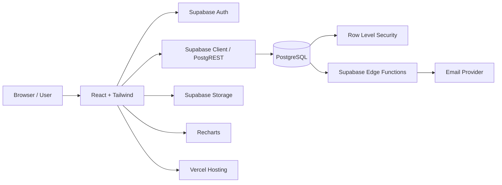
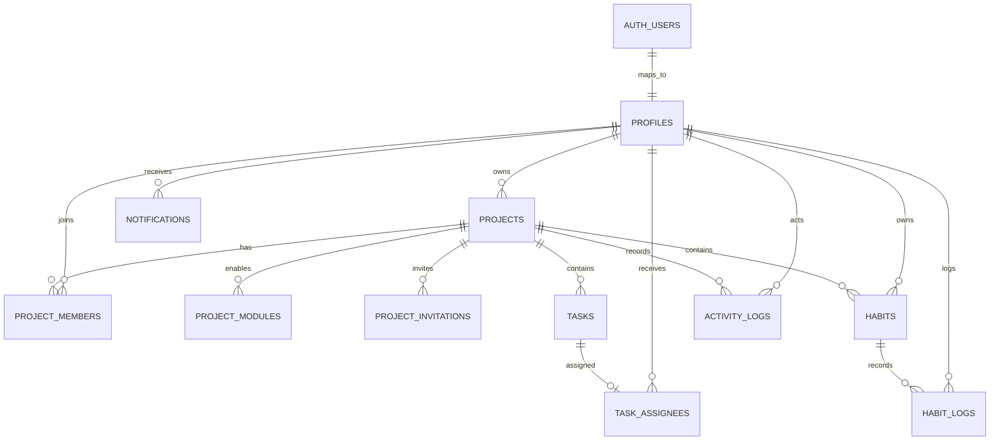
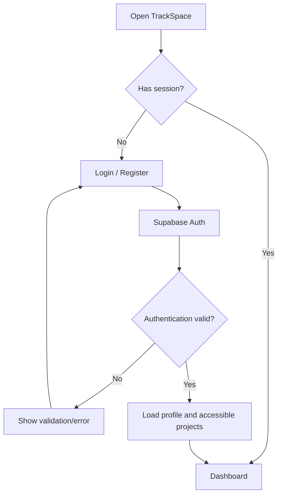
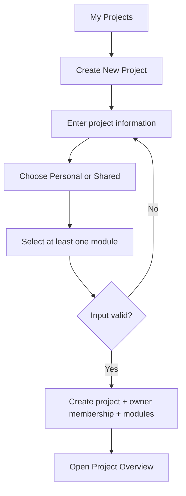
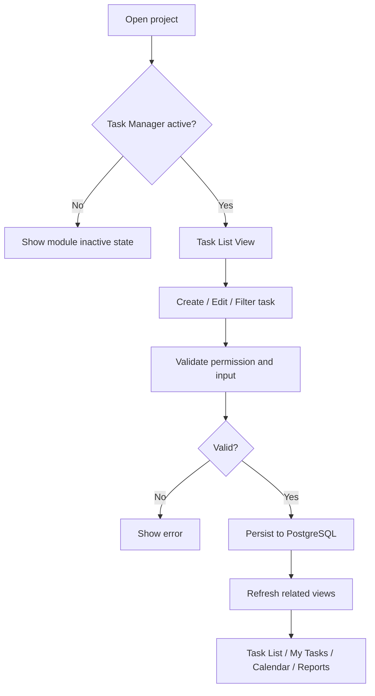
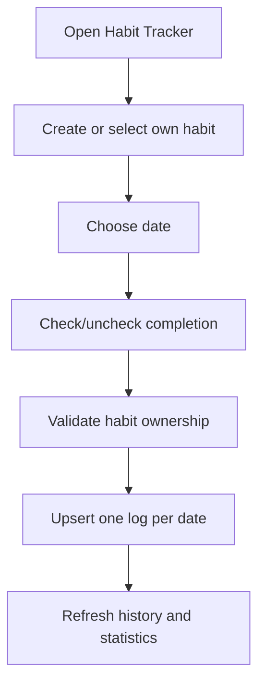
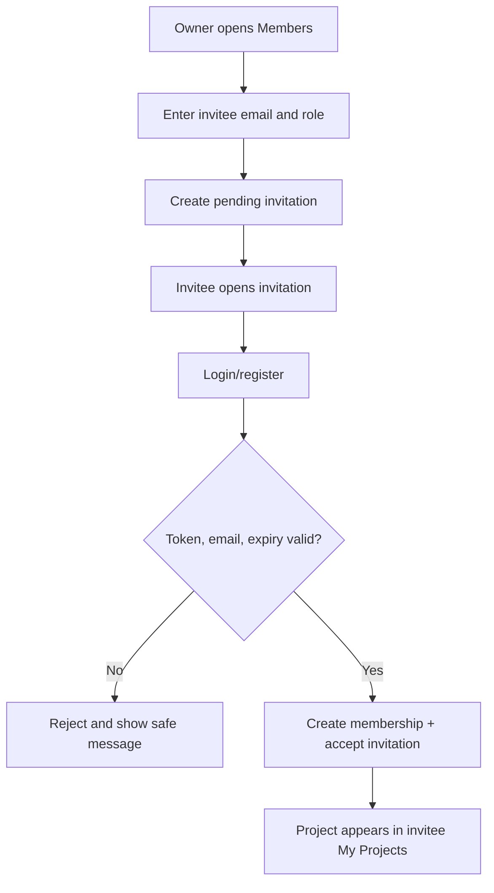

# TrackSpace — Product Requirements Document (PRD)

**Versi:** 1.0-draft  
**Tanggal:** 8 November 2026  
**Status:** Draft untuk validasi produk dan implementasi  
**Platform:** Web application  
**Target implementasi:** React, Tailwind CSS, Supabase (PostgreSQL + Auth + Storage), Recharts, Vercel, Google Antigravity

---

## Document Control

| Item | Keterangan |
|---|---|
| Product | TrackSpace |
| Document type | Product Requirements Document |
| Purpose | Single source of truth untuk desain, implementasi, pengujian, dan deployment |
| Audience | Product owner, UI/UX designer, frontend developer, backend developer, QA |
| Baseline | Keputusan dan batasan yang diberikan dalam brief produk |
| Status | Draft; keputusan terbuka harus disetujui sebelum implementasi terkait |

## Daftar Isi

1. Product Overview
2. Product Principles dan Scope
3. Personas, Roles, dan Access Control
4. Information Architecture dan Dashboard
5. Project Management
6. Task Manager
7. Habit Tracker
8. Calendar
9. Progress & Reports
10. Collaboration System
11. Notification System
12. UI/UX Requirements dan Design System
13. Technical Architecture
14. Database Design dan ERD
15. Functional Requirements
16. Non-Functional Requirements
17. User Stories dan User Flows
18. MVP Scope dan Development Roadmap
19. Testing Strategy
20. Risks, Mitigations, dan Future Development
21. Open Questions / Pending Decisions
22. Consistency Review dan Definition of Done

---

# 1. Product Overview

## 1.1 Ringkasan Produk

TrackSpace adalah aplikasi web manajemen project multi-project dengan workspace modular. Satu akun dapat membuat atau bergabung ke beberapa project. Setiap project bertipe **Personal** atau **Shared** dan dapat mengaktifkan kombinasi modul yang dibutuhkan: Task Manager, Habit Tracker, Calendar, serta Progress & Reports.

**Product concept:** *A flexible workspace to organize projects, tasks, habits, and collaboration in one place.*

TrackSpace tidak memaksa semua project memakai fitur yang sama. Pengaturan modul dilakukan per project, sedangkan identitas akun, autentikasi, dan navigasi global digunakan bersama.

## 1.2 Masalah Pengguna

- Informasi project dan aktivitas tersebar di beberapa aplikasi.
- Pengguna memerlukan satu akun untuk mengelola banyak konteks project.
- Kebutuhan setiap project berbeda sehingga fitur harus dapat dipilih.
- Project kelompok memerlukan pembagian tanggung jawab dan pemantauan.
- Aktivitas, jadwal, dan laporan perlu mengambil data dari sumber yang sama agar konsisten.

## 1.3 Tujuan Produk

1. Memungkinkan pengguna mengelola banyak project dari satu akun.
2. Menyediakan pengalaman yang konsisten untuk project personal dan kolaboratif.
3. Memungkinkan konfigurasi modul per project tanpa menghapus data saat modul dinonaktifkan.
4. Menghubungkan task, habit, calendar, dan laporan melalui data persisten.
5. Menegakkan isolasi data dan hak akses di backend.

## 1.4 Non-goals Versi Pertama

- Pengganti penuh untuk enterprise project-management suite.
- Kanban Board (secara eksplisit tidak termasuk; Task Manager menggunakan List View).
- Chat real-time atau video meeting.
- Billing, subscription, dan multi-tenant enterprise administration.
- Integrasi eksternal seperti Google Calendar pada MVP.
- Aplikasi native iOS/Android.
- Workflow automation kompleks.

## 1.5 Indikator Keberhasilan Awal

Target numerik belum ditentukan. Untuk MVP, keberhasilan dinilai melalui metrik yang dapat diukur setelah instrumentasi disepakati:
- Pengguna dapat mendaftar, login, dan membuat project tanpa bantuan.
- Project dapat dibuat dengan tipe dan modul yang dipilih.
- Task dan habit tersimpan serta tetap tersedia setelah login ulang.
- Perubahan task tercermin pada My Tasks, Calendar, Overview, dan Reports sesuai modul aktif.
- Pengguna tanpa keanggotaan tidak dapat membaca atau mengubah data project.
- Tidak ada kehilangan data ketika modul dinonaktifkan dan diaktifkan kembali.

---

# 2. Product Principles dan Scope

## 2.1 Prinsip Inti

| Prinsip | Implementasi |
|---|---|
| Multi-project | Relasi project ke pemilik dan anggota; satu akun dapat terkait ke banyak project |
| Flexible workspace | Modul dikonfigurasi pada tingkat project |
| Personal & Shared | Personal hanya memiliki owner; Shared mendukung keanggotaan dan role |
| Modular | Modul dipilih saat pembuatan dan dapat diubah melalui Project Settings |
| Consistent experience | Pola navigasi, task, form, dan komponen konsisten |
| Scalable | Skema modular dan service layer terpisah dari tampilan |
| Data integrity | Foreign key, constraint, transaksi, dan RLS |
| Persistent data | Data disimpan di PostgreSQL; UI tidak menjadi sumber kebenaran |

## 2.2 Definisi Istilah

- **Project:** ruang kerja dengan nama, pemilik, tipe, konfigurasi modul, dan data terkait.
- **Module:** kemampuan yang dapat diaktifkan atau dinonaktifkan per project.
- **Project member:** pengguna yang memiliki akses ke Shared Project melalui keanggotaan aktif.
- **Owner:** pembuat/pemilik project dengan kendali tertinggi.
- **Assignee:** anggota yang ditugaskan pada task.
- **Habit:** definisi kebiasaan yang dimiliki seorang pengguna dalam konteks project.
- **Habit log:** catatan penyelesaian habit pada tanggal tertentu.
- **Activity log:** catatan peristiwa penting untuk audit/tampilan aktivitas.

## 2.3 Aturan Modular

1. Project harus memiliki minimal satu modul aktif.
2. Modul aktif disimpan sebagai konfigurasi project, bukan hanya state frontend.
3. Menonaktifkan modul mengubah status konfigurasi menjadi nonaktif; data modul tidak dihapus.
4. Modul nonaktif disembunyikan dari navigasi dan tidak menyumbang data pada tampilan integrasi seperti Calendar dan Reports.
5. Mengaktifkan kembali modul menampilkan data lama.
6. Operasi perubahan modul harus memeriksa izin pengguna dan mencatat activity log.
7. Penghapusan permanen data modul, bila kelak diperlukan, harus menjadi aksi terpisah dengan konfirmasi dan kebijakan retensi.

---

# 3. Personas, Roles, dan Access Control

## 3.1 Jenis Project

| Aspek | Personal | Shared |
|---|---|---|
| Pemilik | Satu owner | Satu owner |
| Anggota lain | Tidak ada | Admin dan Member |
| Assignee | Tidak diperlukan pada MVP | Anggota project |
| Habit | Milik owner | Habit per pengguna |
| Undangan | Tidak tersedia | Owner mengundang |
| Visibilitas | Owner saja | Anggota aktif sesuai role |
| Konversi | Dapat diubah menjadi Shared | Tetap Shared |

**Aturan:** Personal Project hanya dapat diakses oleh owner. Perubahan Personal menjadi Shared tidak boleh otomatis membuka akses; owner harus secara eksplisit mengundang anggota.

## 3.2 Role Definitions

| Kemampuan | Owner | Admin | Member |
|---|---:|---:|---:|
| Melihat project | Ya | Ya | Ya |
| Mengubah detail project | Ya | Tidak, kecuali izin eksplisit | Tidak |
| Menghapus project | Ya | Tidak | Tidak |
| Mengaktifkan/menonaktifkan modul | Ya | Hanya jika owner mengizinkan | Tidak |
| Mengundang anggota | Ya | Hanya jika owner mengizinkan | Tidak |
| Menghapus anggota | Ya | Hanya jika owner mengizinkan; tidak dapat menghapus owner | Tidak |
| Mengubah role | Ya | Tidak pada MVP | Tidak |
| Membuat task | Ya | Ya | Ya, sesuai kebijakan project |
| Mengedit task | Ya | Ya | Task yang dibuat/ditugaskan kepadanya; kebijakan final perlu dikonfirmasi |
| Menghapus task | Ya | Ya | Tidak pada default MVP |
| Mengubah status task | Ya | Ya | Task yang ditugaskan kepadanya |
| Assign task | Ya | Ya | Tidak |
| Melihat laporan | Ya | Ya | Ya |
| Membuat/mengelola habit sendiri | Ya | Ya | Ya |
| Mengubah habit log pengguna lain | Tidak secara default | Tidak secara default | Tidak |

**Catatan keamanan:** Owner tetap memiliki akses penuh. Admin dan Member hanya memperoleh izin yang dinyatakan. Jangan menyimpulkan izin dari nama role saja; implementasikan policy yang eksplisit.

## 3.3 Authorization Rules

- Setiap tabel yang menyimpan data project harus memiliki `project_id` atau relasi yang dapat ditelusuri ke project.
- Setiap query harus dibatasi oleh identitas pengguna dan keanggotaan project.
- RLS PostgreSQL menjadi kontrol otorisasi utama; pemeriksaan frontend hanya untuk UX.
- Pengguna yang membuka URL project tanpa akses harus menerima respons tidak berwenang/tidak ditemukan yang aman, tanpa membocorkan keberadaan data.
- Service-role key Supabase tidak boleh dikirim ke browser.
- Perubahan role, undangan, atau keanggotaan harus dilakukan melalui operasi backend yang tervalidasi.

---

# 4. Information Architecture dan Dashboard

## 4.1 Navigasi Global

1. Dashboard
2. My Projects
3. My Tasks
4. Calendar
5. Settings

Navigasi project berada di dalam workspace project:
- Overview
- Modul aktif (Task Manager, Habit Tracker, Calendar, Progress & Reports)
- Project Settings

## 4.2 Main Dashboard

Dashboard adalah ringkasan lintas-project untuk pengguna yang sedang login.

Komponen:
- Summary cards: jumlah project, total task, To Do, In Progress, Done.
- Upcoming deadlines: task yang memiliki due date mendatang dan belum Done.
- Recent activities: aktivitas terbaru pada project yang dapat diakses pengguna.
- Project list/cards: project milik pengguna atau project yang diikuti.
- CTA `Create New Project`.

Semua angka dihitung dari database dan hanya dari project yang boleh diakses pengguna. Kartu task hanya menghitung task dari project dengan Task Manager aktif.

## 4.3 Dashboard vs Project Overview

| Main Dashboard | Project Overview |
|---|---|
| Cakupan lintas seluruh project yang dapat diakses | Hanya satu project |
| Ringkasan personal pengguna | Ringkasan project |
| Daftar semua project | Detail project yang sedang dibuka |
| Upcoming deadlines lintas project | Deadline project tersebut |
| Aktivitas lintas project | Aktivitas dalam project tersebut |

## 4.4 My Projects dan My Tasks

- **My Projects:** daftar project milik sendiri dan project Shared yang diikuti; tampilkan tipe, role, modul aktif, dan ringkasan.
- **My Tasks:** gabungan task dari project yang dapat diakses. Setiap baris wajib menampilkan nama project asal, status, priority, due date, dan assignee.
- Filter My Tasks: status, priority, due date, project, dan (untuk Shared) penugasan kepada pengguna.
- My Tasks tidak memberi izin baru. Aksi yang tersedia tetap mengikuti izin project asal.

---

# 5. Project Management

## 5.1 Create New Project Flow

### Step 1 — Project Information
- `name` wajib, panjang 1–100 karakter setelah trim.
- `description` opsional, maksimum awal yang disarankan 1.000 karakter.
- `icon` opsional, gunakan pilihan ikon bawaan.
- `color` opsional, pilih dari palet terkontrol.

### Step 2 — Project Type
- `Personal`
- `Shared`

### Step 3 — Choose Features
- Task Manager
- Habit Tracker
- Calendar
- Progress & Reports

Minimal satu modul wajib aktif. Calendar dan Progress & Reports dapat diaktifkan meskipun sumber datanya belum ada; tampilkan empty state yang sesuai. Calendar hanya menampilkan kategori data dari modul sumber yang aktif.

### Step 4 — Create
Backend membuat project, membership owner, dan konfigurasi modul secara konsisten. Operasi sebaiknya dilakukan dalam satu transaksi/RPC agar tidak terjadi project tanpa owner atau konfigurasi parsial.

## 5.2 Project Workspace

Header menampilkan icon, nama, tipe, dan akses cepat ke Project Settings. Overview menampilkan deskripsi, statistik aktual, deadline terdekat, dan aktivitas terbaru.

Navigasi modul hanya menampilkan modul aktif. Akses URL langsung ke modul nonaktif harus ditolak atau diarahkan ke Overview dengan pesan bahwa modul sedang nonaktif.

## 5.3 Project Settings

- Edit nama, deskripsi, icon, warna.
- Aktifkan/nonaktifkan modul.
- Konversi Personal menjadi Shared.
- Kelola anggota dan role untuk Shared.
- Hapus project (Owner saja).

## 5.4 Konversi Personal ke Shared

MVP mendukung konversi satu arah Personal → Shared. Setelah konversi:
1. Owner melihat penjelasan bahwa project akan menjadi ruang kolaborasi.
2. Project type diperbarui menjadi Shared.
3. Owner tetap menjadi owner dan satu-satunya anggota sampai undangan diterima.
4. Data lama tetap terkait dengan project yang sama.
5. Habit yang sudah ada tetap milik owner; anggota baru membuat habit masing-masing.
6. Tidak ada akses otomatis bagi pengguna lain.

Konversi Shared → Personal tidak termasuk MVP karena memerlukan aturan untuk anggota, assignee, dan audit trail.

## 5.5 Deletion dan Archiving

Untuk MVP, project deletion hanya oleh Owner dengan konfirmasi eksplisit. Gunakan penghapusan terkontrol dan kebijakan cascade yang terdokumentasi. Rekomendasi: tambahkan soft delete/archive (`archived_at`) lebih dahulu agar salah hapus dapat dipulihkan; penghapusan permanen dapat ditunda. Keputusan retensi final tercantum pada Open Questions.

---

# 6. Task Manager

## 6.1 Scope dan Tampilan

Task Manager menggunakan **List View saja**. Tidak ada Kanban Board pada MVP maupun rancangan navigasi awal.

Kolom minimum:
- Task name
- Status
- Priority
- Due date
- Assignee (Shared)
- Updated date
- Action menu

Tampilan mendukung pencarian, filter, sorting, pagination atau incremental loading, serta empty/loading/error state.

## 6.2 Task Data

| Field | Tipe konseptual | Aturan |
|---|---|---|
| id | UUID | Primary key |
| project_id | UUID | Wajib; FK projects |
| title | text | Wajib, 1–160 karakter |
| description | text | Opsional |
| status | enum/text constrained | `todo`, `in_progress`, `done` |
| priority | enum/text constrained | `low`, `medium`, `high` |
| due_date | date nullable | Tanggal lokal tanpa jam untuk MVP |
| created_by | UUID | FK profiles/auth user |
| created_at / updated_at | timestamptz | Otomatis |
| completed_at | timestamptz nullable | Diisi saat status menjadi Done; dikosongkan jika dibuka kembali |

Status dapat berubah dua arah kapan saja. Task Done tetap disimpan dan ditampilkan; default filter boleh menyembunyikan task Done hanya jika pengguna memilih filter tersebut.

## 6.3 Task Operations

- Create, read, update, delete.
- Update status dan priority.
- Set/remove due date.
- Assign/unassign member pada Shared.
- Search berdasarkan title dan description.
- Filter status, priority, deadline (overdue/today/upcoming/no date).
- Sort due date, priority, created date, updated date.
- Validasi assignee harus merupakan anggota aktif project.
- Semua mutasi memperbarui `updated_at` dan menghasilkan activity log untuk peristiwa penting.

## 6.4 Task Detail

**MVP:**
- Title, description, status, priority, due date, assignee, created/updated metadata.
- Riwayat perubahan status sederhana melalui activity log bila tersedia.
- Form edit dan delete dengan konfirmasi.

**Ditunda:**
- Subtasks: berguna tetapi menambah kompleksitas agregasi progress.
- Comments: memerlukan moderasi, notifikasi, dan aturan visibilitas.
- Attachments: memerlukan Storage, batas ukuran, validasi tipe, dan signed URL.
- Rich-text notes: dapat digantikan description pada MVP.

## 6.5 Global My Tasks

My Tasks melakukan query lintas project yang diizinkan dan mengembalikan `project_id` serta informasi project. Untuk Shared, tampilkan task yang ditugaskan kepada pengguna dan task lain yang dapat ia lihat sesuai role. Filter “Assigned to me” hanya bermakna untuk Shared Project.

---

# 7. Habit Tracker

## 7.1 Model Habit

Habit adalah definisi kebiasaan dalam sebuah project dan dimiliki oleh satu pengguna (`owner_user_id`). Pada Personal Project, owner habit adalah pemilik project. Pada Shared Project, setiap anggota dapat membuat habit sendiri.

Field minimum:
- `id`, `project_id`, `owner_user_id`
- `name`, `description`
- `frequency_type`: `daily` atau `weekly`
- `schedule_days`: array hari dalam minggu untuk weekly
- `is_active`
- `created_at`, `updated_at`

## 7.2 Habit Logs

Satu log merepresentasikan pencatatan habit untuk satu tanggal:
- `id`, `habit_id`, `project_id`, `user_id`, `log_date`
- `status` atau `completed` boolean
- `note` opsional
- `created_at`, `updated_at`

Constraint unik `(habit_id, log_date)` mencegah pencatatan ganda untuk tanggal yang sama. `user_id` pada log harus konsisten dengan pemilik habit; validasi dilakukan di backend/database.

## 7.3 Habit Tracking UX

- Daftar habit aktif.
- Checklist berdasarkan tanggal terpilih.
- Navigasi tanggal.
- Riwayat dan consistency calendar.
- Statistik mingguan/bulanan.
- Habit yang diarsipkan tidak muncul pada checklist aktif tetapi riwayat log tetap tersimpan.

Completion rate dihitung dari hari terjadwal dalam rentang yang dipilih:
`completion_rate = completed scheduled occurrences / total scheduled occurrences × 100%`.
Hari yang belum tiba tidak masuk denominator. Hari tanpa jadwal tidak dihitung. Jika denominator nol, tampilkan `—`, bukan 0%.

## 7.4 Shared Habit Privacy

- Member hanya dapat membuat dan mengelola habit miliknya sendiri.
- Member hanya dapat membaca dan mengubah log miliknya sendiri pada default MVP.
- Owner/Admin tidak otomatis dapat mengubah habit log pribadi anggota.
- Laporan agregat tim, bila kelak diaktifkan, harus memakai persetujuan dan aturan privasi yang jelas. MVP menampilkan statistik habit pribadi kepada pemilik habit saja.

---

# 8. Calendar

## 8.1 Views dan Data

Calendar menyediakan Monthly View dan Weekly View. Sumber data:
- Task due dates dari Task Manager aktif.
- Jadwal habit dari Habit Tracker aktif.
- Aktivitas project yang memiliki tanggal dan layak ditampilkan.

Setiap item memiliki kategori visual yang konsisten dan dapat difilter.

## 8.2 Module Dependency

- Task Manager nonaktif: task tidak ditampilkan.
- Habit Tracker nonaktif: jadwal habit tidak ditampilkan.
- Calendar nonaktif: halaman Calendar project tidak dapat dibuka, meskipun sumber data masih aktif.
- Jika Calendar aktif tetapi semua sumber tidak aktif/kosong, tampilkan empty state.
- Main Calendar global hanya menggabungkan item dari project yang dapat diakses dan modul terkait yang aktif.

## 8.3 Date Synchronization

- Due date task disimpan sebagai `date`, bukan timestamp, karena MVP memperlakukan deadline sebagai tanggal.
- Habit log memakai `date`.
- Aktivitas dengan waktu spesifik (bila ditambahkan kemudian) memakai `timestamptz`.
- Perubahan due date task langsung tercermin pada Calendar setelah query/cache diperbarui.
- Menghapus due date menghapus item task dari Calendar, bukan menghapus task.
- Menonaktifkan sumber modul menyembunyikan item tanpa menghapus record.

---

# 9. Progress & Reports

## 9.1 Task Metrics

- Total task = seluruh task dalam project dengan Task Manager aktif.
- Done = task berstatus `done`.
- In Progress = task berstatus `in_progress`.
- To Do = task berstatus `todo`.
- Completion percentage = `Done / Total task × 100%`.

Jika total task = 0, tampilkan `—` atau empty state “Belum ada task”; jangan membagi dengan nol atau menampilkan angka palsu.

Task completion percentage adalah snapshot status saat ini, bukan velocity atau produktivitas historis.

## 9.2 Habit Metrics

Tampilkan statistik hanya untuk habit milik pengguna yang sedang melihat laporan pada MVP. Completion rate menggunakan rumus pada Bagian 7.3. Jangan menggabungkan log anggota menjadi skor tim tanpa keputusan privasi.

## 9.3 Charts

Recharts dapat digunakan untuk:
- Distribusi status task.
- Task selesai per minggu (berdasarkan `completed_at`).
- Habit completion per minggu/bulan.

Grafik hanya dirender jika ada data yang memadai. Label periode dan zona waktu harus konsisten.

## 9.4 Activity Metrics

Shared Project dapat menampilkan jumlah aktivitas per anggota dari activity log, dengan batasan bahwa metrik aktivitas tidak boleh dipresentasikan sebagai ukuran kinerja individu tanpa konteks. MVP menampilkan feed aktivitas, bukan ranking produktivitas.

---

# 10. Collaboration System

## 10.1 Invitation Lifecycle

Status:
- `pending`: undangan dibuat dan belum diproses.
- `accepted`: penerima menerima; membership aktif dibuat.
- `expired`: melewati masa berlaku tanpa diterima.
- `revoked` (status tambahan yang direkomendasikan): owner membatalkan undangan.

Flow:
1. Owner memasukkan email.
2. Backend memvalidasi format, role yang diundang, dan keanggotaan/undangan duplikat.
3. Sistem membuat invitation token acak yang disimpan dalam bentuk hash, dengan expiry.
4. Penerima membuka tautan dan login/registrasi.
5. Backend memverifikasi token, email akun, status, dan expiry.
6. Jika valid, buat `project_members` dan ubah invitation menjadi accepted secara atomik.
7. Tautan tidak dapat digunakan kembali.

Email delivery memerlukan provider email/Edge Function; jika belum dikonfigurasi, MVP dapat menggunakan alur undangan internal yang aman, tetapi tidak boleh mengklaim email telah terkirim.

## 10.2 Member Management

- Owner dapat melihat daftar anggota dan role.
- Owner dapat mengubah role Admin/Member.
- Owner dapat menghapus anggota; penghapusan tidak boleh menghapus data historis yang dibuat anggota.
- Owner tidak dapat menghapus dirinya sendiri jika belum mentransfer kepemilikan (transfer ownership bukan MVP).
- Admin hanya mengelola anggota jika diberi izin eksplisit.

## 10.3 Task Assignment

- Task dapat memiliki nol atau satu assignee pada MVP untuk menyederhanakan UX.
- Assignee harus menjadi anggota aktif Shared Project.
- Jika anggota dihapus, task tidak dihapus; assignee di-null-kan atau ditandai unassigned melalui proses yang konsisten.
- Multi-assignee dapat menjadi pengembangan berikutnya.

## 10.4 Direct URL Protection

Semua halaman project melakukan pemeriksaan sesi dan otorisasi. RLS wajib melindungi setiap tabel. UI tidak boleh mengandalkan ID yang sulit ditebak sebagai kontrol keamanan. Endpoint/RPC juga harus memvalidasi keanggotaan dan role.

---

# 11. Notification System

## 11.1 MVP

- Notifikasi undangan dalam aplikasi (jika alur undangan diimplementasikan).
- Notifikasi task assignment.
- Notifikasi perubahan penting pada task yang ditugaskan kepada pengguna.

## 11.2 Setelah MVP

- Email invitation delivery.
- Reminder deadline terjadwal.
- Preferensi notifikasi per pengguna/project.
- Digest harian/mingguan.
- Push notification.

## 11.3 Aturan

- Notifikasi disimpan dalam tabel `notifications`.
- Setiap notifikasi memiliki penerima, tipe, payload ringkas, waktu dibuat, dan `read_at`.
- Jangan menyimpan data sensitif yang tidak diperlukan dalam payload.
- Reminder terjadwal memerlukan scheduler/cron dan zona waktu pengguna; jangan mengandalkan timer browser.

---

# 12. UI/UX Requirements dan Design System

## 12.1 Visual Direction

Modern SaaS dashboard, minimalis, profesional, mudah dipindai, desktop-first, responsif. Hindari dekorasi berlebihan dan penggunaan warna sebagai satu-satunya penanda status.

## 12.2 Rekomendasi Design Tokens

| Token | Rekomendasi |
|---|---|
| Primary | Indigo `#4F46E5` |
| Primary hover | Indigo gelap `#4338CA` |
| Text utama | Slate `#0F172A` |
| Text sekunder | Slate `#64748B` |
| Background | `#F8FAFC` |
| Surface | `#FFFFFF` |
| Border | `#E2E8F0` |
| Success | `#16A34A` |
| Warning | `#D97706` |
| Danger | `#DC2626` |
| Typography | Inter atau system sans-serif |
| Base font | 14–16 px |
| Spacing | Skala 4 px (4, 8, 12, 16, 24, 32) |
| Radius | 8–12 px untuk cards/inputs |
| Shadow | Subtle; gunakan untuk elevasi, bukan dekorasi |

Warna status harus memiliki label teks/icon agar tetap dapat dipahami oleh pengguna dengan gangguan persepsi warna.

## 12.3 Components

- Buttons: primary, secondary, tertiary/ghost, destructive; state default/hover/disabled/loading.
- Forms: label, helper text, validation message, required indicator.
- Cards: summary, project, activity.
- Tables/list: header jelas, row hover, responsive overflow atau mobile card layout.
- Navigation: sidebar desktop; drawer/bottom navigation yang teruji untuk mobile.
- Feedback: toast untuk aksi singkat, inline error untuk validasi, skeleton untuk loading.
- Empty state: jelaskan kondisi dan CTA berikutnya.
- Dialog: konfirmasi penghapusan dan perubahan konfigurasi penting.

## 12.4 Responsive Behavior

- Desktop: sidebar tetap, konten utama fleksibel.
- Tablet: sidebar dapat diciutkan.
- Mobile: navigasi ringkas; tabel task berubah menjadi daftar kartu atau horizontal scroll yang dapat digunakan.
- Form tidak boleh membutuhkan hover.
- Target interaksi sentuh disarankan minimal 44×44 CSS px.

## 12.5 Accessibility

- Kontras teks mengikuti WCAG 2.2 AA sebagai target.
- Semua input memiliki label.
- Navigasi keyboard dan focus state terlihat.
- Status tidak hanya dibedakan dengan warna.
- Dialog memiliki focus management dan dapat ditutup dengan keyboard.

---

# 13. Technical Architecture

## 13.1 High-Level Architecture



## 13.2 Frontend

Rekomendasi struktur feature-oriented:

```text
src/
  app/                 # router, providers, app shell
  components/          # reusable UI components
  features/
    auth/
    dashboard/
    projects/
    tasks/
    habits/
    calendar/
    reports/
    collaboration/
    notifications/
  lib/                 # supabase client, utilities, validators
  hooks/
  types/
  styles/
```

- React menangani komponen dan interaksi.
- Tailwind CSS menyediakan design tokens dan konsistensi styling.
- Router menjaga pemisahan route global dan route project.
- Form validation dilakukan di client untuk UX dan di server/database untuk integritas.
- Recharts hanya untuk visualisasi; sumber angka tetap query database.

## 13.3 Backend dan Database

Supabase menyediakan PostgreSQL, Auth, RLS, dan Storage. Browser menggunakan anon/publishable key dengan sesi pengguna; RLS membatasi data. Operasi sensitif (menerima undangan, perubahan role, operasi multi-tabel) sebaiknya melalui SQL function/RPC atau Edge Function dengan validasi server-side.

## 13.4 Authentication Flow

1. User register/login melalui Supabase Auth.
2. Supabase mengelola sesi dan token.
3. Aplikasi mengambil profil yang terhubung ke `auth.users`.
4. Route terlindungi memeriksa sesi.
5. Query ke database menyertakan JWT pengguna; RLS menentukan baris yang dapat diakses.
6. Logout mengakhiri sesi dan membersihkan state/cache privat.

## 13.5 Authorization dan RLS

- Aktifkan RLS untuk semua tabel yang dapat diakses dari client.
- Gunakan helper SQL seperti `is_project_member(project_id)` dan `has_project_role(project_id, roles)` dengan `SECURITY DEFINER` secara hati-hati, `search_path` tetap, dan hak execute terbatas.
- Hindari policy yang memanggil tabel yang sama secara rekursif.
- Uji akses sebagai anon, user non-member, member, admin, dan owner.
- Service role hanya untuk server-side secret; tidak pernah di frontend.

## 13.6 Data Fetching dan State

- Gunakan TanStack Query atau pola data-fetching setara untuk cache, loading, retry, invalidation.
- State lokal untuk modal, filter sementara, dan form.
- Server state untuk project/task/habit.
- Setelah mutasi, invalidate query terkait: task update harus menyegarkan Task List, My Tasks, Calendar, Overview, dan Reports bila relevan.
- Realtime Supabase bukan kebutuhan wajib MVP; gunakan invalidation/refetch terlebih dahulu.

## 13.7 Error Handling dan Observability

- Validasi input di client dan database.
- Tampilkan pesan ramah pengguna; log teknis tidak memuat token atau data rahasia.
- Tangani network error, session expiry, permission denied, conflict, dan not found.
- Tambahkan error monitoring setelah deployment; pilih provider pada tahap implementasi.
- Gunakan migration SQL yang terversi dan seed data khusus development/test.

## 13.8 Storage

Attachment tidak termasuk MVP. Jika ditambahkan:
- Private bucket.
- Path terikat ke project/task.
- RLS Storage policy.
- Signed URL dengan expiry.
- Validasi ukuran dan MIME type.
- Penghapusan file saat record dihapus melalui proses terkontrol.

## 13.9 Deployment

- Vercel untuk frontend.
- Supabase project terpisah untuk development dan production.
- Environment variables untuk URL dan anon key; secret hanya pada server/Edge Function.
- Migration dijalankan secara terkendali sebelum release.
- Preview deployment untuk review; production release setelah smoke test.
- Konfigurasi redirect URL Auth dan domain production harus tepat.

---

# 14. Database Design dan ERD

## 14.1 Konvensi

- Primary key menggunakan UUID.
- Timestamp disimpan sebagai `timestamptz` dalam UTC.
- Tanggal tanpa jam menggunakan `date`.
- `created_at` dan `updated_at` tersedia pada tabel utama.
- Gunakan FK dan constraint; hindari menyimpan array relasional seperti daftar member di kolom project.
- `auth.users` dikelola Supabase; `profiles.id` mereferensikan `auth.users.id`.

## 14.2 Tabel MVP

| Tabel | Fungsi dan kolom utama | Relasi / constraint penting |
|---|---|---|
| `profiles` | `id uuid PK`, `display_name`, `avatar_url`, timestamps | `id` FK ke `auth.users.id` |
| `projects` | `id`, `owner_id`, `name`, `description`, `icon`, `color`, `project_type`, `archived_at`, timestamps | FK owner ke profiles; check type Personal/Shared |
| `project_members` | `id`, `project_id`, `user_id`, `role`, `joined_at` | FK project/profile; unique `(project_id,user_id)`; role owner/admin/member |
| `project_modules` | `id`, `project_id`, `module_key`, `is_enabled`, timestamps | Unique `(project_id,module_key)`; module key dibatasi |
| `project_invitations` | `id`, `project_id`, `email`, `role`, `token_hash`, `status`, `expires_at`, `invited_by`, timestamps | Token hash unique; status constrained; jangan simpan token mentah |
| `tasks` | `id`, `project_id`, `title`, `description`, `status`, `priority`, `due_date`, `created_by`, `completed_at`, timestamps | FK project/profile; check status dan priority |
| `task_assignees` | `task_id`, `user_id`, `assigned_by`, `created_at` | PK gabungan; FK task/profile; MVP validasi maksimal satu assignee melalui aturan aplikasi atau desain satu assignee |
| `habits` | `id`, `project_id`, `owner_user_id`, `name`, `description`, `frequency_type`, `schedule_days`, `is_active`, timestamps | FK project/profile; check frequency |
| `habit_logs` | `id`, `habit_id`, `project_id`, `user_id`, `log_date`, `completed`, `note`, timestamps | Unique `(habit_id,log_date)`; user harus pemilik habit |
| `activity_logs` | `id`, `project_id`, `actor_id`, `entity_type`, `entity_id`, `action`, `metadata`, `created_at` | FK project/profile; metadata dibatasi dan tidak menyimpan rahasia |
| `notifications` | `id`, `recipient_id`, `project_id`, `type`, `payload`, `read_at`, `created_at` | FK recipient/profile; project nullable untuk notifikasi global |

## 14.3 Tabel Ditunda

| Tabel | Alasan ditunda |
|---|---|
| `task_comments` | Membutuhkan kebijakan edit/delete, notifikasi, dan moderasi |
| `task_attachments` | Membutuhkan Storage, validasi file, signed URL, dan cleanup |
| `subtasks` | Menambah aturan progress parent-child dan UX |
| `notification_preferences` | Dibutuhkan saat preferensi notifikasi lebih kompleks |
| `audit_events` terpisah | Activity log MVP cukup untuk feed; audit keamanan lebih ketat dapat dipisahkan |
| `project_transfers` | Transfer ownership bukan MVP |

## 14.4 Indeks yang Disarankan

- `projects(owner_id)`, `projects(project_type)`.
- `project_members(user_id, project_id)` dan unique `(project_id,user_id)`.
- `project_modules(project_id, module_key)` unique.
- `tasks(project_id, status)`, `tasks(project_id, due_date)`, `tasks(updated_at)`.
- `task_assignees(user_id, task_id)`.
- `habits(project_id, owner_user_id, is_active)`.
- `habit_logs(habit_id, log_date)` unique dan `habit_logs(user_id, log_date)`.
- `activity_logs(project_id, created_at desc)`.
- `notifications(recipient_id, read_at, created_at desc)`.
- `project_invitations(project_id, status)` dan unique token hash.

Indeks final harus dikonfirmasi dengan query plan dan volume data nyata; jangan menambahkan indeks berlebihan.

## 14.5 Relationship Notes

- Satu project memiliki satu owner dan satu atau lebih membership records; owner juga tercatat sebagai member dengan role `owner`.
- Satu project memiliki satu row per modul di `project_modules`.
- Satu task berada pada tepat satu project.
- Satu task dapat memiliki nol atau satu assignee pada MVP.
- Satu habit dimiliki satu user dalam satu project.
- Satu habit memiliki banyak log, satu log per tanggal.
- Activity log dan notification adalah data pendukung, bukan sumber kebenaran status task/habit.

## 14.6 ERD



## 14.7 RLS Policy Design Matrix

| Data | Read | Insert | Update | Delete |
|---|---|---|---|---|
| profiles | Pemilik profil; field publik minimum dapat dibuka sesuai kebutuhan | Trigger/proses signup | Pemilik profil | Tidak dari client pada MVP |
| projects | Owner/member aktif | Auth user sebagai owner | Owner | Owner |
| project_members | Anggota aktif; owner mengelola | Owner/invite acceptance function | Owner atau fungsi role khusus | Owner |
| project_modules | Anggota aktif | Owner | Owner; Admin hanya jika diizinkan | Owner; lebih baik toggle daripada delete |
| invitations | Owner/admin berizin; penerima via token aman | Owner | Fungsi undangan | Owner/revoke function |
| tasks | Anggota aktif | Role yang diizinkan | Owner/Admin; Member sesuai aturan task | Owner/Admin |
| task_assignees | Anggota aktif | Owner/Admin | Owner/Admin | Owner/Admin |
| habits | Pemilik habit; owner dapat melihat hanya bila kebijakan disetujui | Anggota aktif untuk dirinya | Pemilik habit | Pemilik habit |
| habit_logs | Pemilik habit/log | Pemilik habit | Pemilik habit | Pemilik habit |
| activity_logs | Anggota aktif | Trigger/RPC terpercaya | Tidak dari client | Tidak dari client |
| notifications | Penerima | Backend/RPC | Penerima hanya `read_at` | Penerima atau retention job |

**Catatan implementasi:** matriks ini adalah rancangan awal, bukan SQL policy siap produksi. Setiap policy harus ditulis dan diuji. Pada tabel `habits` dan `habit_logs`, validasi kepemilikan perlu menggabungkan `auth.uid()`, project membership, dan kesesuaian `owner_user_id`/`user_id`. Untuk operasi lintas tabel, gunakan function dengan `SECURITY DEFINER` secara minimal dan aman.

---

# 15. Functional Requirements

Priority: **Must** = wajib MVP; **Should** = penting tetapi dapat menyusul jika waktu terbatas; **Could** = opsional; **Won't (MVP)** = tidak dikerjakan pada rilis pertama.

| ID | Requirement | Role | Priority | Preconditions | Expected behavior / Acceptance criteria |
|---|---|---|---|---|---|
| FR-001 | User registration | Guest | Must | Email valid | Akun dibuat; verifikasi email mengikuti konfigurasi Auth; profil dibuat atau tersedia |
| FR-002 | User login/logout | User | Must | Akun tersedia | Login membuat sesi; logout mengakhiri sesi; route privat terlindungi |
| FR-003 | View/edit profile | User | Should | Login | Pengguna dapat mengubah nama tampilan; perubahan tersimpan |
| FR-004 | View dashboard | User | Must | Login | Ringkasan hanya berasal dari project yang dapat diakses |
| FR-005 | Create project | User | Must | Login; nama valid | Project dan owner membership dibuat konsisten |
| FR-006 | Select project type | User | Must | Create flow | Pilihan Personal/Shared tersimpan dengan benar |
| FR-007 | Select modules | User | Must | Minimal satu dipilih | Konfigurasi modul tersimpan per project |
| FR-008 | View project workspace | Member/Owner | Must | Akses project valid | Overview dan modul aktif ditampilkan |
| FR-009 | Edit project details | Owner | Must | Owner | Nama/deskripsi/icon/color tersimpan |
| FR-010 | Enable/disable module | Owner | Must | Owner; minimal satu modul tetap aktif | Navigasi dan integrasi mengikuti konfigurasi; data tidak dihapus |
| FR-011 | Convert Personal to Shared | Owner | Should | Project Personal | Type berubah; owner tetap satu-satunya member sampai undangan diterima |
| FR-012 | Delete/archive project | Owner | Should | Owner; konfirmasi | Project tidak dapat diakses setelah diarsipkan/dihapus sesuai kebijakan |
| FR-013 | View task list | Member | Must | Task Manager aktif | List View menampilkan task yang boleh dilihat |
| FR-014 | Create task | Owner/Admin/Member sesuai policy | Must | Task Manager aktif | Task tersimpan dengan project_id yang benar |
| FR-015 | Edit task | Owner/Admin/authorized Member | Must | Task tersedia dan izin valid | Field yang diizinkan diperbarui |
| FR-016 | Delete task | Owner/Admin | Must | Izin valid; konfirmasi | Task dihapus/diarsipkan sesuai kebijakan; tidak menghapus project |
| FR-017 | Update task status | Owner/Admin/assignee | Must | Task tersedia | Status dapat berubah termasuk Done kembali; completed_at konsisten |
| FR-018 | Set task priority and due date | Authorized task editor | Must | Task tersedia | Nilai tersimpan dan Calendar ter-refresh |
| FR-019 | Assign task | Owner/Admin | Should | Shared; assignee anggota aktif | Assignee valid; task tampil di My Tasks assignee |
| FR-020 | Search/filter/sort tasks | Member | Must | Task Manager aktif | Hasil sesuai query/filter/sort; tidak melewati RLS |
| FR-021 | Global My Tasks | User | Must | Login | Task lintas project ditampilkan dengan project asal |
| FR-022 | Create/edit/archive habit | Member untuk habit sendiri | Must | Habit Tracker aktif | Habit tersimpan pada project dan owner yang benar |
| FR-023 | Log habit by date | Habit owner | Must | Habit aktif; tanggal valid | Satu log per habit per tanggal; dapat diubah oleh pemilik |
| FR-024 | View habit history/stats | Habit owner | Should | Ada habit/log | Riwayat dan completion rate sesuai jadwal |
| FR-025 | View project calendar | Member | Must | Calendar aktif | Monthly/Weekly view menampilkan sumber modul aktif |
| FR-026 | Filter calendar | Member | Should | Calendar aktif | Filter kategori mengubah item yang ditampilkan |
| FR-027 | View progress reports | Member | Must | Reports aktif | Statistik dihitung dari data aktual; zero-task state aman |
| FR-028 | Invite member | Owner | Should | Shared Project | Invitation dibuat dengan expiry dan status pending |
| FR-029 | Accept invitation | Invitee | Should | Token valid, email cocok | Membership dibuat atomik; invitation accepted |
| FR-030 | Manage roles/members | Owner | Should | Shared Project | Perubahan role/removal tersimpan dan berlaku pada akses berikutnya |
| FR-031 | View notifications | User | Could | Login | Notifikasi hanya dapat dibaca penerimanya |
| FR-032 | Mark notification read | Recipient | Could | Notifikasi milik user | `read_at` diperbarui |
| FR-033 | View activity feed | Member | Should | Akses project | Aktivitas terbaru ditampilkan tanpa membocorkan data |
| FR-034 | Enforce RLS | All | Must | Seluruh tabel client-accessible | User non-member tidak dapat membaca/mengubah data melalui API langsung |
| FR-035 | Responsive layouts | All | Must | Semua halaman | Alur inti dapat digunakan pada desktop, tablet, dan mobile |

---

# 16. Non-Functional Requirements

| Area | Requirement terukur / kriteria uji |
|---|---|
| Security | RLS aktif pada seluruh tabel yang terekspos; tidak ada service-role key di client; test non-member harus gagal |
| Privacy | User hanya melihat data sesuai project membership dan kepemilikan habit; minimisasi payload |
| Performance | Target awal: halaman inti tampil usable dalam ≤3 detik pada koneksi broadband normal untuk dataset uji; query umum ditinjau dengan EXPLAIN |
| Scalability | Pagination/limit untuk daftar; indeks pada FK dan filter utama; tidak mengambil seluruh dataset sekaligus |
| Reliability | Mutasi penting memiliki validasi dan error state; operasi multi-tabel atomik |
| Usability | Form memiliki label dan validasi; empty/loading/error states tersedia; alur create project dapat diselesaikan tanpa dokumentasi |
| Maintainability | Feature-based folder; migration terversi; komponen reusable; tipe data konsisten |
| Responsive | Uji lebar 360 px, 768 px, dan 1440 px; tidak ada aksi inti yang terpotong |
| Data integrity | FK, unique constraint, check constraint; task assignee harus anggota project |
| Backup/recovery | Gunakan backup sesuai paket Supabase; uji prosedur restore sebelum production; retensi final dikonfirmasi |
| Accessibility | Target WCAG 2.2 AA untuk kontras, keyboard, label, focus, dan semantic structure |

Angka performa adalah target awal untuk diuji, bukan jaminan. Baseline perlu disesuaikan setelah pengukuran pada environment deployment.

---

# 17. User Stories dan User Flows

## 17.1 User Stories

| Role | User story |
|---|---|
| Guest | As a guest, I want to register and log in, so that I can access my workspace |
| Owner | As an owner, I want to create multiple projects, so that I can separate different areas of work |
| Owner | As an owner, I want to choose modules, so that each project contains only the tools I need |
| Owner | As an owner, I want to configure members and roles, so that collaboration remains controlled |
| Admin | As an admin, I want to manage permitted project tasks, so that work can progress without owner intervention |
| Member | As a member, I want to view and update tasks assigned to me, so that I understand my responsibilities |
| Member | As a member, I want to record my own habits, so that my personal tracking remains private |
| User | As a user, I want to see tasks across projects, so that I can organize my workload in one place |

## 17.2 Register/Login Flow



## 17.3 Create Project Flow



## 17.4 Task Flow



## 17.5 Habit Flow



## 17.6 Invitation Flow



## 17.7 Calendar and Reports Flow

- Calendar reads only active source modules and accessible projects.
- Reports read persisted task/habit records and compute aggregates.
- A task update invalidates the relevant query keys; UI refetches authoritative data.
- If a module is disabled, its records remain stored but are excluded from current integrated views.

---

# 18. MVP Scope dan Development Roadmap

## 18.1 MVP Definition

MVP harus membuktikan alur inti: autentikasi → membuat project modular → mengelola task/habit → melihat integrasi calendar/report → menjaga isolasi data. Kolaborasi dasar termasuk dalam MVP bertahap, tetapi undangan email otomatis dan notifikasi kompleks dapat menyusul.

## 18.2 Prioritized Scope

| Area | MVP | Later |
|---|---|---|
| Authentication | Register, login, logout, profile minimal | OAuth providers, MFA |
| Project | Create/edit/archive, Personal/Shared, module selection | Shared → Personal, ownership transfer |
| Task | List View, CRUD, status, priority, due date, search/filter/sort | Subtasks, comments, attachments, recurring tasks |
| Assignment | Satu assignee pada Shared (Should) | Multi-assignee |
| Habit | CRUD, daily/weekly schedule, logs, history dasar | Shared aggregate analytics |
| Calendar | Monthly/Weekly, task + habit sources | External calendar sync, reminders |
| Reports | Task metrics dan habit metrics dasar | Custom reports, export |
| Collaboration | Members, roles, invitation lifecycle dasar | Advanced permission matrix, guest access |
| Notifications | In-app assignment/invitation minimal jika collaboration dirilis | Email digest, push, scheduled reminders |
| Platform | Responsive web, RLS, deployment | Native apps, enterprise controls |

## 18.3 Recommended Roadmap

Urutan rekomendasi sedikit mengubah rencana awal: database, auth, dan authorization foundation harus dibangun sebelum modul data.

| Phase | Fokus | Deliverables / exit criteria |
|---|---|---|
| 0 | Product & technical foundation | Finalize open decisions; repo; environments; schema draft; design tokens |
| 1 | UI/UX foundation | App shell, routing, sidebar, responsive primitives, empty/loading/error states |
| 2 | Supabase foundation + Auth | Auth, profiles, migrations, RLS baseline, protected routes |
| 3 | Project Management | Project CRUD, Personal/Shared, modules, owner membership, settings |
| 4 | Task Manager | List View, CRUD, filters, status, due date, My Tasks |
| 5 | Habit Tracker | Habit CRUD, ownership, schedule, logs, history |
| 6 | Calendar & Reports | Source-aware calendar, calculated metrics, charts |
| 7 | Collaboration | Invitations, members, roles, assignment, RLS hardening |
| 8 | QA & Deployment | Functional/integration/security/responsive tests; production release |

**Dependency note:** Collaboration foundations (membership and RLS) begin in Phase 2–3 even if invitation UI is delivered in Phase 7. Do not postpone authorization design until the end.

---

# 19. Testing Strategy

## 19.1 Test Layers

- Unit: utility functions, progress formulas, date/schedule calculations, validators.
- Integration: Supabase queries, RPC, module gating, invitation acceptance.
- RLS/security: role matrix and direct API attempts.
- End-to-end: critical user flows.
- Responsive/accessibility: viewport, keyboard, contrast, focus.
- Regression: cross-module synchronization after each release.

## 19.2 Sample Test Cases

| Test ID | Scenario | Steps / setup | Expected result |
|---|---|---|---|
| TC-001 | Register valid account | Submit valid email/password | Account created; user can authenticate |
| TC-002 | Unauthenticated route | Open `/dashboard` without session | Redirect to login; no private data rendered |
| TC-003 | Create project with no module | Submit project with zero modules | Validation blocks submission |
| TC-004 | Create Personal Project | Create with Task Manager | Project created; owner membership exists; no other user can access |
| TC-005 | Module disable/enable | Create task; disable Task Manager; enable again | Task hidden while disabled and retained after re-enable |
| TC-006 | Task status reversal | Set To Do → Done → In Progress | Latest status persists; completed_at cleared when reopened |
| TC-007 | Task due date sync | Change task due date | Calendar reflects new date after refresh/invalidation |
| TC-008 | My Tasks source | Create tasks in two accessible projects | Both appear with correct project labels |
| TC-009 | Assignee validation | Assign task to non-member | Backend rejects assignment |
| TC-010 | Habit log uniqueness | Log same habit/date twice | One log row is updated, not duplicated |
| TC-011 | Habit privacy | Member A attempts to edit Member B log | RLS denies operation |
| TC-012 | Calendar module gating | Disable Habit Tracker | Habit schedule disappears; log remains |
| TC-013 | Zero-task report | Open Reports with no tasks | Empty state/—; no divide-by-zero |
| TC-014 | Invite valid member | Invite and accept with matching account email | Membership created once; invite accepted |
| TC-015 | Expired invite | Accept after expiry | Rejected; no membership created |
| TC-016 | Direct URL unauthorized | Non-member opens project URL/API | No project data returned |
| TC-017 | Role enforcement | Member attempts delete project | Backend denies |
| TC-018 | Removed member | Remove member then reuse old session | Subsequent reads/writes denied by RLS |
| TC-019 | Responsive task list | Open at 360 px viewport | Task data/actions remain usable |
| TC-020 | Module minimum | Disable last active module | Operation blocked with explanatory message |

## 19.3 Release Gate

Rilis tidak boleh dilakukan jika:
- RLS test untuk non-member gagal.
- Ada service-role secret di bundle frontend.
- Data project bocor antar-user.
- Modul nonaktif masih mengeluarkan data pada Calendar/Reports.
- Perhitungan laporan salah pada project kosong.
- Alur utama gagal pada viewport mobile.

---

# 20. Risks, Mitigations, dan Future Development

| Risiko | Dampak | Mitigasi |
|---|---|---|
| Scope terlalu luas | MVP tidak selesai | Kunci Must Have; tunda comments, attachments, subtasks, integrations |
| Permission keliru | Kebocoran data | RLS sejak awal; policy matrix; negative tests |
| Data antar-project tercampur | Laporan dan task salah | Wajib project_id, FK, query scoping, tests |
| Modul dinonaktifkan menghapus data | Kehilangan data | Toggle status saja; regression test |
| Sinkronisasi antar-modul terlambat | UI tidak konsisten | Query invalidation; sumber data tunggal |
| Habit privacy tidak jelas | Data personal terbuka | Habit owner dan log owner eksplisit; RLS |
| Invitation token disalahgunakan | Akses tidak sah | Token acak, hash, expiry, email match, one-time acceptance |
| Perubahan schema sulit | Bug dan downtime | Versioned migrations, staging, rollback plan |
| Kalender dan zona waktu | Tanggal bergeser | `date` untuk due date/log; `timestamptz` untuk event waktu |
| Query lambat | UX buruk | Pagination, indeks terarah, query plan |

## 20.1 Future Development Candidates

- Subtasks dan task dependencies.
- Comments dan attachments.
- Recurring tasks dan habit reminders.
- Email/push notifications.
- Google Calendar integration.
- Export CSV/PDF.
- Multi-assignee.
- Advanced permission customization.
- Shared habit analytics dengan kontrol privasi.
- Archive/restore dan transfer ownership.
- Audit log yang lebih lengkap.

---

# 21. Open Questions / Pending Decisions

Keputusan berikut belum ditetapkan dalam brief dan harus diselesaikan sebelum implementasi terkait. Rekomendasi sementara diberikan agar pengembangan dapat direncanakan.

| ID | Pertanyaan | Rekomendasi sementara |
|---|---|---|
| OQ-01 | Apakah email wajib diverifikasi sebelum memakai aplikasi? | Aktifkan verifikasi email untuk production |
| OQ-02 | Apakah Admin boleh mengundang anggota dan mengelola modul? | Default tidak; Owner dapat memberi izin eksplisit pada iterasi berikutnya |
| OQ-03 | Apakah Member boleh mengedit semua task atau hanya task miliknya/yang ditugaskan? | Hanya task yang dibuat atau ditugaskan kepadanya; Owner/Admin dapat mengedit semua |
| OQ-04 | Apakah satu task dapat memiliki lebih dari satu assignee? | Satu assignee pada MVP |
| OQ-05 | Apakah Calendar dan Progress & Reports boleh aktif tanpa Task Manager/Habit Tracker? | Ya; tampilkan empty state dan data sumber yang tersedia |
| OQ-06 | Apakah task deletion permanen atau soft delete? | Soft delete/archive direkomendasikan |
| OQ-07 | Apakah project dapat diarsipkan dan dipulihkan? | Ya, gunakan `archived_at`; final UI perlu diputuskan |
| OQ-08 | Apakah Shared habit bersifat privat sepenuhnya? | Ya pada MVP; agregasi tim ditunda |
| OQ-09 | Apakah undangan harus dikirim lewat email pada MVP? | Undangan aman dengan email provider jika tersedia; jika tidak, jangan mengklaim email terkirim |
| OQ-10 | Berapa lama masa berlaku invitation? | Rekomendasi awal 7 hari, dapat dikonfigurasi |
| OQ-11 | Apakah Shared → Personal diperbolehkan? | Tidak pada MVP |
| OQ-12 | Apakah pengguna dapat menghapus akun dan meminta penghapusan data? | Tetapkan kebijakan privasi/retensi sebelum production |
| OQ-13 | Zona waktu default dan preferensi pengguna? | Simpan timezone pada profile; gunakan tanggal lokal untuk due date/habit |
| OQ-14 | Batas ukuran/nama/volume data? | Tetapkan setelah uji prototipe dan kebutuhan deployment |
| OQ-15 | Apakah task activity history harus lengkap untuk audit? | Activity feed dasar pada MVP; audit trail penuh ditunda |

---

# 22. Consistency Review dan Definition of Done

## 22.1 Consistency Review

| Area | Pemeriksaan konsistensi | Status rancangan |
|---|---|---|
| Product principles ↔ modules | Pemilihan modul per project dan minimal satu modul | Konsisten |
| Personal/Shared ↔ roles | Personal owner-only; Shared memiliki membership | Konsisten |
| Task ↔ Calendar | Calendar hanya membaca task jika Task Manager aktif | Konsisten |
| Habit ↔ privacy | Habit dan log memiliki owner eksplisit | Konsisten |
| Module toggle ↔ data | Disable menyembunyikan, bukan menghapus | Konsisten |
| Reports ↔ database | Metrics dihitung dari records aktual | Konsisten |
| My Tasks ↔ authorization | Query lintas project tetap dibatasi RLS | Konsisten |
| Invitation ↔ membership | Membership dibuat setelah token valid diterima | Konsisten |
| Roadmap ↔ dependencies | Auth/RLS/membership foundation mendahului collaboration UI | Konsisten |
| Task UI | List View saja; Kanban tidak termasuk | Konsisten |

## 22.2 Definition of Done per Feature

Sebuah fitur dinyatakan selesai jika:
1. UI mengikuti design system dan mendukung loading, empty, error, serta success state.
2. Validasi input berjalan di client dan backend/database.
3. Data tersimpan dan dapat dibaca kembali setelah reload/login ulang.
4. RLS diuji untuk owner, admin, member, non-member, dan anon sesuai relevansi.
5. Mutasi memperbarui tampilan lintas modul yang terkait.
6. Tidak ada data dummy pada alur produksi.
7. Unit/integration/E2E test yang relevan lulus.
8. Dokumentasi teknis dan migration diperbarui.

## 22.3 Catatan Implementasi untuk Google Antigravity

Gunakan PRD ini sebagai spesifikasi, tetapi bangun bertahap. Sebelum menghasilkan kode:
- Minta Antigravity memeriksa struktur repo dan mengusulkan implementation plan.
- Implementasikan satu phase/feature pada satu waktu.
- Minta migration SQL, RLS policies, dan test cases bersama fitur terkait.
- Jangan menaruh secret di frontend.
- Jangan mengganti keputusan produk tanpa persetujuan.
- Setelah setiap phase, jalankan test dan review perubahan sebelum lanjut.

**Dokumen ini adalah baseline PRD draft.** Bagian Open Questions harus dikonfirmasi dan diperbarui menjadi keputusan final sebelum fitur terkait masuk production.
